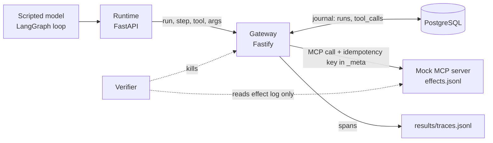

# AgentCrash

AgentCrash is a durable MCP agent runtime plus a crash-point verifier. A TypeScript tool gateway journals every tool call in PostgreSQL, sends an idempotency key with each call and recovers after a crash. A verifier kills the gateway at every tool-call boundary, restarts it, and compares the effects recorded by independent mock MCP servers with a clean run.

## Problem

An agent that calls tools can be killed at any moment. A restart then has to guess whether the last call happened. Guess "no" and an effect happens twice; guess "yes" and it is lost. The gateway has four boundaries where a kill matters:

| Point | Where the process dies | Risk without a journal | What AgentCrash does |
|---|---|---|---|
| P1 `after_planned` | after the call is journaled, before it is sent | call forgotten | row is `PLANNED`; recovery executes it |
| P2 `after_exec` | after the server replied, before `DONE` is stored | call repeated | `SENT` row; idempotent tool is resent with the same key and the server returns the stored result; a non-idempotent tool is reconciled with a probe or ends as `UNKNOWN` |
| P3 `after_commit` | after `DONE` is committed, before the HTTP reply | call repeated | the repeated call finds `DONE` and returns the stored result |
| P4 `awaiting_approval` | while a call waits for an operator | approval lost | row stays `AWAITING_APPROVAL`; run stays `WAITING_APPROVAL` |

## Architecture



- The runtime never talks to an MCP server; every call goes through `POST /v1/runs/{run}/steps/{n}/call`.
- Idempotency key: `sha256(run_id:step_no:tool:canonical_json(args))`.
- Spans (`run`, `step.<n>`, `journal.plan`, `journal.sent`, `mcp.call`, `journal.done`, `recovery.scan`, `recovery.resume`) go to the console and `results/traces.jsonl`.
- Auth: an in-repo OAuth 2.0 client-credentials endpoint (`gateway/src/authserver.ts`) issues short-lived ES256 JWTs with one scope per tool (`tool:<name>`) and serves a JWKS; the gateway verifies signature, expiry, issuer, audience and scope with `jose` on every call. Set `AGENTCRASH_AUTH=1` to run the stack with it.

## Quick start

Windows 11, PowerShell, PostgreSQL on `localhost:5432` (user and password `postgres`), Node 20+, Python 3.12, `uv`, `just`.

```powershell
just up            # creates the agentcrash database, migrates, builds, starts mock, gateway, runtime
just test          # unit tests, both languages
just integration   # crash-point integration tests and the runtime end-to-end test
just sweep bank_5  # 20-point crash sweep, writes results/sweep_bank_5_<utc>.json
just sweep-unsafe  # same sweep with the journal bypassed; must report duplicates
just check         # lint + test + integration + 20-point sweep
just report        # regenerate the Results section below from results/
just down
```

### Reading a sweep report

`results/sweep_<scenario>_<utc>.json` has `{scenario, git_sha, started, rows[], summary}`. Each row is one `(step, point)`: `crashed` (the hook fired), `duplicates` (effects beyond the intended multiset), `lost` (intended effects missing), `unknown` (calls left `UNKNOWN` and surfaced), `recovery_ms` (gateway restart until the run settled) and `pass`. Pass and fail come only from the mock servers' effect logs; the verifier never uses the journal for that. The command exits 1 if any row has a duplicate or a lost effect.

## Results (generated)

<!-- results:start -->

### Crash sweep (safe)

Source: `results/sweep_bank_5_20261125T160523Z.json` (git `e5a5d75120`).

| metric | value |
|---|---|
| points | 20 |
| duplicates | 0 |
| lost | 0 |
| unknown surfaced | 1 |
| recovery p50 (ms) | 2840 |
| recovery p95 (ms) | 3256 |
| recovery max (ms) | 3256 |

<details><summary>Every point</summary>

| step | point | crashed | dup | lost | unknown | pass |
|---|---|---|---|---|---|---|
| 0 | P1_after_planned | True | 0 | 0 | 0 | True |
| 0 | P2_after_exec | True | 0 | 0 | 0 | True |
| 0 | P3_after_commit | True | 0 | 0 | 0 | True |
| 0 | P4_awaiting_approval | False | 0 | 0 | 0 | True |
| 1 | P1_after_planned | True | 0 | 0 | 0 | True |
| 1 | P2_after_exec | True | 0 | 0 | 0 | True |
| 1 | P3_after_commit | True | 0 | 0 | 0 | True |
| 1 | P4_awaiting_approval | True | 0 | 0 | 0 | True |
| 2 | P1_after_planned | True | 0 | 0 | 0 | True |
| 2 | P2_after_exec | True | 0 | 0 | 0 | True |
| 2 | P3_after_commit | True | 0 | 0 | 0 | True |
| 2 | P4_awaiting_approval | False | 0 | 0 | 0 | True |
| 3 | P1_after_planned | True | 0 | 0 | 0 | True |
| 3 | P2_after_exec | True | 0 | 0 | 0 | True |
| 3 | P3_after_commit | True | 0 | 0 | 0 | True |
| 3 | P4_awaiting_approval | False | 0 | 0 | 0 | True |
| 4 | P1_after_planned | True | 0 | 0 | 0 | True |
| 4 | P2_after_exec | True | 0 | 0 | 1 | True |
| 4 | P3_after_commit | True | 0 | 0 | 0 | True |
| 4 | P4_awaiting_approval | False | 0 | 0 | 0 | True |

</details>

### Crash sweep (unsafe mode, expected to fail)

Source: `results/sweep_bank_5_unsafe_20261125T160839Z.json` (git `e5a5d75120`).

| metric | value |
|---|---|
| points | 20 |
| duplicates | 10 |
| lost | 0 |
| unknown surfaced | 0 |
| recovery p50 (ms) | 2865 |
| recovery p95 (ms) | 8232 |
| recovery max (ms) | 8232 |

<details><summary>Every point</summary>

| step | point | crashed | dup | lost | unknown | pass |
|---|---|---|---|---|---|---|
| 0 | P1_after_planned | True | 0 | 0 | 0 | True |
| 0 | P2_after_exec | True | 1 | 0 | 0 | False |
| 0 | P3_after_commit | True | 1 | 0 | 0 | False |
| 0 | P4_awaiting_approval | False | 0 | 0 | 0 | True |
| 1 | P1_after_planned | True | 0 | 0 | 0 | True |
| 1 | P2_after_exec | True | 1 | 0 | 0 | False |
| 1 | P3_after_commit | True | 1 | 0 | 0 | False |
| 1 | P4_awaiting_approval | False | 0 | 0 | 0 | True |
| 2 | P1_after_planned | True | 0 | 0 | 0 | True |
| 2 | P2_after_exec | True | 1 | 0 | 0 | False |
| 2 | P3_after_commit | True | 1 | 0 | 0 | False |
| 2 | P4_awaiting_approval | False | 0 | 0 | 0 | True |
| 3 | P1_after_planned | True | 0 | 0 | 0 | True |
| 3 | P2_after_exec | True | 1 | 0 | 0 | False |
| 3 | P3_after_commit | True | 1 | 0 | 0 | False |
| 3 | P4_awaiting_approval | False | 0 | 0 | 0 | True |
| 4 | P1_after_planned | True | 0 | 0 | 0 | True |
| 4 | P2_after_exec | True | 1 | 0 | 0 | False |
| 4 | P3_after_commit | True | 1 | 0 | 0 | False |
| 4 | P4_awaiting_approval | False | 0 | 0 | 0 | True |

</details>

### Security tests

Source: `results/security_20261125T163041Z.json`.

| metric | value |
|---|---|
| total | 51 |
| blocked | 51 |
| failed | 0 |

<!-- results:end -->

## Limits

- A server that reports success without acting is not covered.
- PostgreSQL disk corruption is not covered.
- An effect that cannot be reconciled, such as an email already sent by a tool with no probe, ends as `UNKNOWN` and waits for an operator; it is never retried silently.
- Single-crash sweeps unless stated otherwise in the results above.
- Not covered: undoing effects (no compensation), real third-party systems, a UI.
